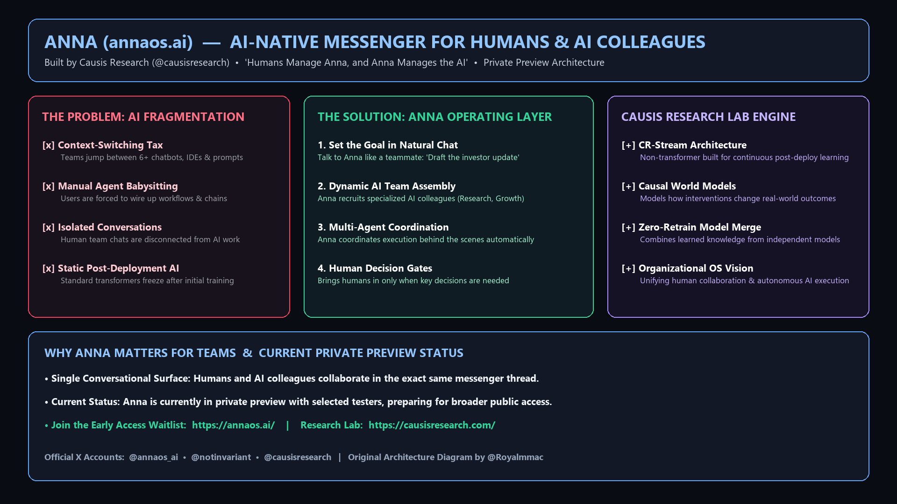

# Introducing Anna (`annaos.ai`): How Causis Research Is Replacing AI Tool Sprawl with an AI-Native Messenger

*By Marco Aurélio Sugamele ([`@Royalmmac`](https://x.com/Royalmmac))*

- **6-Part X Thread (`@Royalmmac`):** [`https://x.com/Royalmmac/status/2121291907410051134`](https://x.com/Royalmmac/status/2121291907410051134) -> [`https://x.com/Royalmmac/status/2121294779090944173`](https://x.com/Royalmmac/status/2121294779090944173)
- **Product & Waitlist:** Anna (`https://annaos.ai/`) • **Research Lab:** Causis Research (`https://causisresearch.com/`)
- **Official X Accounts:** [`@annaos_ai`](https://x.com/annaos_ai) • [`@notinvariant`](https://x.com/notinvariant) • [`@causisresearch`](https://x.com/causisresearch)

---

## 1. The Real Bottleneck in AI Today: Tool Sprawl

Over the last two years, AI models got dramatically better, but actually using them across a team got much messier. Most builders I know have half a dozen tabs open at all times: one chatbot for brainstorming, another for research, a coding assistant in the IDE, and a fragile node-based automation tool gluing them together.

Instead of saving time, this fragmentation created a new kind of busywork:
- **Constant Context Copy-Pasting:** You spend half your afternoon copying outputs from one AI tool into another because none of them share memory.
- **Manual Agent Babysitting:** Most "agent workflows" still force humans to wire up prompts, manage API keys, and debug intermediate steps.
- **Isolated Single-Player Chats:** Your human team talks in Slack or Telegram, while everyone's AI work happens in private, disconnected browser tabs.

---

## 2. What Is Anna (`annaos.ai`)?

Built by **Causis Research (`@causisresearch`)**, **Anna (`@annaos_ai`)** takes a completely different approach: it is an **AI-native messenger where humans and AI colleagues work together inside the same conversations**.

Instead of asking you to wire up agents or switch between models, Anna operates on a simple rule of thumb:

> **"Humans manage Anna, and Anna manages the AI."**

### How the Workflow Looks
1. **Describe the Goal in Plain English:** You message Anna inside a shared thread the same way you would brief a project lead—for example, asking her to map out three competitors' pricing changes and put together a positioning draft.
2. **Organizing the Right AI Colleagues:** Anna breaks down the objective and pulls in the right specialized AI colleagues (research, strategy, writing, operations) for the job.
3. **Coordinating the Work Behind the Scenes:** Anna coordinates handoffs between those AI colleagues and keeps the task moving without requiring you to configure complex workflows.
4. **Bringing Humans In When It Counts:** When a task needs a real judgment call, direction change, or final sign-off, Anna brings you and your teammates back into the thread.

---

## 3. Why the Team Behind Anna Matters: Causis Research (`causisresearch.com`)

What makes Anna particularly interesting to follow is that it isn't just a UI wrapper around a third-party API. It is being built by **Causis Research (`@causisresearch`)**, an independent AI lab led by `@notinvariant` that is researching fundamental improvements beyond static transformer models:

| Research Area | What Causis Research Is Exploring | Why It Matters for Anna |
| :--- | :--- | :--- |
| **CR-Stream Architecture** | Non-transformer architectures designed for **continuous learning** after deployment | Helps AI systems adapt to how a team actually works instead of starting from zero every session |
| **Causal World Models** | Understanding **cause and effect** (how an action changes an outcome) rather than surface-level correlation | Essential for reliable multi-step planning and real-world coordination |
| **Zero-Retrain Model Merge** | Combining capabilities from separately trained models without full retraining | Makes it practical to coordinate specialized AI colleagues under one roof |

---

## 4. Current Status & How to Join the Waitlist

Anna is currently in **private preview** with a small group of early testers while the team refines the experience for a wider release.

If you want to follow their progress or get early access when new spots open up:

- **Join the Waitlist:** [https://annaos.ai/](https://annaos.ai/)
- **Read About the Lab:** [https://causisresearch.com/](https://causisresearch.com/)
- **Follow on X:** [`@annaos_ai`](https://x.com/annaos_ai) • [`@notinvariant`](https://x.com/notinvariant) • [`@causisresearch`](https://x.com/causisresearch)

*(Note: This breakdown and visual diagram were created as an original entry for the Anna Creator Challenge on Superteam Earn.)*
