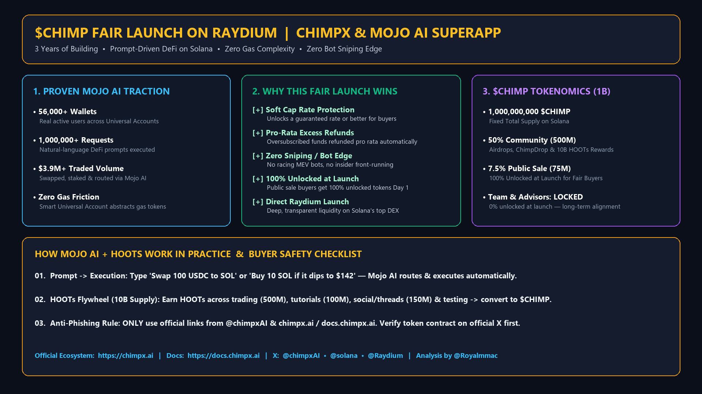

# Why the $CHIMP Fair Launch on Raydium Stands Out: Product Traction, Mojo AI, and Tokenomics

*By Marco Aurélio Sugamele ([`@Royalmmac`](https://x.com/Royalmmac))*

- **8-Part X Thread (`@Royalmmac`):** [`https://x.com/Royalmmac/status/2121288435617219039`](https://x.com/Royalmmac/status/2121288435617219039) -> [`https://x.com/Royalmmac/status/2121291170672206252`](https://x.com/Royalmmac/status/2121291170672206252)
- **Ecosystem Links:** ChimpX (`https://chimpx.ai`) • Mojo AI Docs (`https://docs.chimpx.ai`) • Launch Venue: Raydium on Solana (`@chimpxAI` • `@solana` • `@Raydium`)
- **Official Launch Thread:** [`https://x.com/ChimpxAI/status/2108481669653291199`](https://x.com/ChimpxAI/status/2108481669653291199)

---

## 1. Shipping the Product Before Launching the Token

Most token launches in crypto ask retail buyers to fund a whitepaper and hope a working product shows up two years later. What caught my attention when researching **ChimpX (`@chimpxAI`)** is that the team did the exact opposite.

They spent **three years building** and shipping **Mojo AI**, a personal AI superapp for managing money on Solana, before bringing `$CHIMP` to market on **Raydium (`@Raydium`)**.

### Verified Pre-Launch Traction (`docs.chimpx.ai`)
| Metric | Official Milestone | Why It Matters |
| :--- | :--- | :--- |
| **Time Spent Building** | **3+ Years** | A live, working product instead of a speculative promise |
| **Onboarded Users** | **56,000+ Wallets** | Real onchain users already active inside Universal Accounts |
| **Executed Prompts** | **1,000,000+ Requests** | Proven everyday demand for prompt-driven DeFi |
| **Cumulative Volume** | **$3.9M+ Traded** | Real capital routed across swaps, staking, and limit orders |

---

## 2. What Problem Does Mojo AI Actually Solve?

Even for experienced users, standard DeFi workflows are tedious: managing seed phrases, checking gas balances across chains, comparing DEX pools, and verifying raw transaction prompts.

**Mojo AI** replaces those manual steps with a **Smart Universal Account** controlled through plain text:

1. **Plain-English Execution:** Instead of clicking through multiple DEX screens, you type what you want:
   - *"Swap 100 USDC to SOL at the best available route"*
   - *"Buy 10 SOL if the price dips to $142"*
   - *"Stake my idle assets into the highest-yield verified pool"*
2. **Gas Abstraction:** You don't have to micro-manage gas tokens or bridge mechanics manually; Mojo AI handles routing and execution under the hood.
3. **Self-Custodial Ownership:** Even though Mojo AI automates the execution layer, users keep self-custodial ownership of their Universal Account.

---

## 3. How the `$CHIMP` Fair Launch on Raydium Protects Retail Buyers

Anyone who has participated in a typical Solana token launch knows the three usual traps: **MEV sniper bots** buying block zero, **predatory bonding curves** that punish anyone who joins 30 seconds late, and **insider unlocks** dumping on day-one liquidity.

The **`$CHIMP` Fair Launch on Raydium** is structured specifically to prevent those three issues:

- **Soft Cap Rate Guarantee:** Once the soft cap is met, buyers lock in a **guaranteed token rate or better**.
- **Pro-Rata Refunds on Oversubscription:** If the pool is oversubscribed, extra committed funds are **refunded pro rata automatically**, so nobody overpays.
- **No Bot Sniping Advantage:** Because allocations settle through a fair-launch pool rather than a block-zero mempool race, MEV bots get zero edge over regular users.
- **100% Unlocked at Launch for Public Sale Buyers:** All **75,000,000 `$CHIMP`** (7.5% of supply) in the public sale are **100% unlocked on Day 1**, while team and advisor tokens remain **locked at launch**.

---

## 4. `$CHIMP` Tokenomics & The 10B HOOTs Rewards System

Out of the fixed **1,000,000,000 `$CHIMP`** total supply on Solana:

| Allocation Bucket | Share (%) | Token Amount (`$CHIMP`) | Unlock Rules |
| :--- | :--- | :--- | :--- |
| **Community & Ecosystem (ChimpDrop + HOOTs)** | **50.0%** | **500,000,000** | Distributed to active users, testers, and creators across 4 phases |
| **Fair Launch Public Sale (Raydium)** | **7.5%** | **75,000,000** | **100% Unlocked at Launch** for public participants |
| **Team & Advisors** | **Locked** | **Locked at Launch** | **0% Unlocked at TGE** |

### How HOOTs Work Inside Mojo AI
According to `docs.chimpx.ai`, **HOOTs** are activity points (10,000,000,000 total supply) distributed across **4 phases (2.5B HOOTs per phase)** that convert into `$CHIMP` rewards:
- **Trading & Prompt Usage (500M HOOTs):** 100 HOOTs for your first trade + 25 HOOTs per $100 traded through Mojo AI.
- **Product Walkthroughs & Guides (100M HOOTs):** Up to 500,000 HOOTs for practical tutorials showing Mojo AI in action.
- **Community Threads & Education (150M HOOTs):** Rewards for original educational posts and breakdowns.
- **Testing & Bug Reports:** Rewards for users who stress-test Mojo AI and report edge cases.

---

## 5. Practical Safety Checklist Before Joining the Sale

High-profile launches on Solana always attract fake accounts and spoofed links. Before connecting your wallet:

1. **Check the Official X Accounts:** Only follow links posted by **`@chimpxAI`**, **`@solana`**, and **`@Raydium`**.
2. **Verify the Domain:** Use only **`https://chimpx.ai`** and **`https://docs.chimpx.ai`**.
3. **Confirm the Contract Address:** Cross-check the official announcement thread (`https://x.com/ChimpxAI/status/2108481669653291199`) when the token contract is published.
