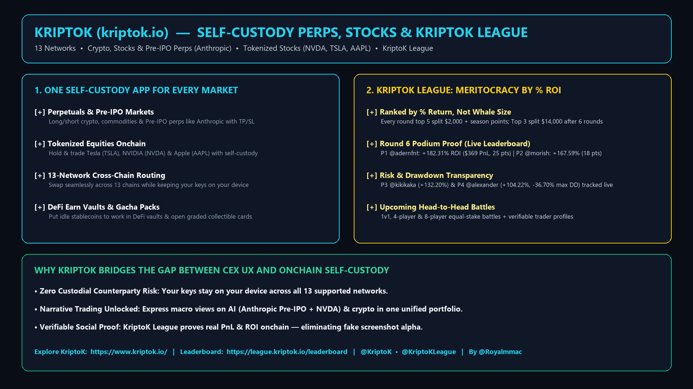

# Exploring KriptoK & KriptoK League: Self-Custody Perps, Tokenized Stocks, and `% ROI` Trading Competitions

*By Marco Aurélio Sugamele ([`@Royalmmac`](https://x.com/Royalmmac))*

- **5-Part X Thread ([`@Royalmmac`]):** [`https://x.com/Royalmmac/status/2121296394946486571`](https://x.com/Royalmmac/status/2121296394946486571) -> [`https://x.com/Royalmmac/status/2121297750868357287`](https://x.com/Royalmmac/status/2121297750868357287)
- **Platform:** KriptoK (`https://www.kriptok.io/`) • **Leaderboard:** KriptoK League (`https://league.kriptok.io/leaderboard`)
- **Official X Accounts:** [`@KriptoK`](https://x.com/KriptoK) • [`@KriptoKLeague`](https://x.com/KriptoKLeague)

---

## 1. Why KriptoK Caught My Eye: CEX Convenience Without Giving Up Custody

Anyone who trades actively onchain knows the usual compromise: centralized exchanges give you a clean mobile interface, but you hand over custody of your funds. On the other hand, staying 100% self-custodial usually means jumping across five different dApps and bridges whenever you want to rotate from crypto perps into tokenized stocks or yield vaults.

While exploring **KriptoK (`https://www.kriptok.io/`)**, what stood out to me is how much they packed into a single **self-custody** wallet and trading app where your keys stay on your device:

1. **Perpetuals Across Crypto, Commodities & Pre-IPO Narratives:**
   - You can go long or short with built-in Take-Profit and Stop-Loss (`TP/SL`) orders.
   - Beyond standard crypto pairs and commodities, KriptoK includes **Pre-IPO perpetual markets like Anthropic**, letting you trade AI and tech narratives directly onchain.
2. **Tokenized Equities (`NVDA`, `TSLA`, `AAPL`):**
   - You can hold and trade tokenized shares of companies like **NVIDIA (`NVDA`)**, **Tesla (`TSLA`)**, and **Apple (`AAPL`)** right alongside your crypto positions, 24/7.
3. **13-Network Cross-Chain Swaps & DeFi Earn:**
   - The app supports sending, receiving, and swapping across **13 networks**, plus **Earn vaults** for idle balances and digital **Gacha collectible card packs**.

---

## 2. KriptoK League (`@KriptoKLeague`): Why Ranking by `% Return` Changes Everything

My favorite part of the ecosystem is **KriptoK League (`https://league.kriptok.io/leaderboard`)**.

In most crypto trading competitions, whales win by default because the leaderboard ranks by raw dollar volume or raw dollar PnL. A whale making 3% on a $500,000 wallet beats a smaller trader who turned $200 into $560.

**KriptoK League ranks traders strictly by percentage return (`% ROI`)**, which makes every round a genuine test of trading skill rather than wallet size.

### Round 6 Leaderboard Snapshot (`league.kriptok.io/leaderboard`)
When I checked the Round 6 standings, the numbers proved that point immediately:

| Rank / Feature | Live Data from Round 6 | Takeaway |
| :--- | :--- | :--- |
| **Prize Structure** | **$2,000 per round** (Top 5) + **$14,000 season pool** (Top 3 across 6 rounds) | Rewards both single-round breakouts and season-long consistency |
| **1st Place (`@adernfnt`)** | **`+182.31%` Return** (`+$369` PnL • `0.00%` Max Drawdown • `25 pts`) | A focused account with `+$369` PnL took 1st place purely on `+182.31%` ROI and zero drawdown |
| **2nd Place (`@morish`)** | **`+167.59%` Return** (`+$4,877` PnL • `-17.07%` Max Drawdown • `18 pts`) | Shows full drawdown transparency next to percentage return |
| **3rd Place (`@kikikaka`)** | **`+132.20%` Return** (`+$3,210` PnL • `0.00%` Max Drawdown • `15 pts`) | Every trade is verified onchain—no fake PnL screenshots |

With equal-stake head-to-head battles (`1v1`, `4-player`, and `8-player` rooms) and verifiable trader profiles also on the roadmap, KriptoK League feels like a genuine meritocracy for onchain traders.

---

## 3. Links to Check It Out

- **KriptoK App:** [https://www.kriptok.io/](https://www.kriptok.io/)
- **KriptoK League Leaderboard:** [https://league.kriptok.io/leaderboard](https://league.kriptok.io/leaderboard)
- **X Updates:** [`@KriptoK`](https://x.com/KriptoK) • [`@KriptoKLeague`](https://x.com/KriptoKLeague)
