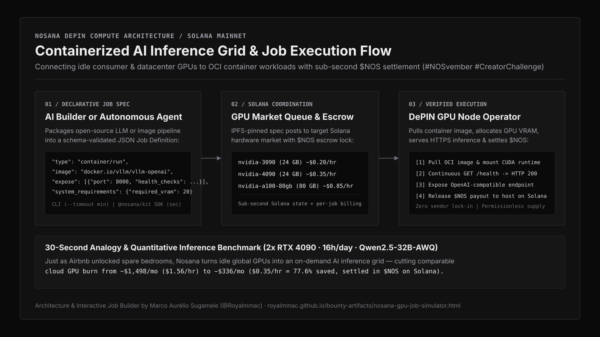

# Explaining Nosana (`#NOSvember`): How Idle GPUs Become an AI Inference Grid on Solana

*By Marco Aurélio Sugamele ([`@Royalmmac`](https://x.com/Royalmmac))*

- **Interactive JSON Job Builder & Cost Benchmark:** [`nosana-gpu-job-simulator.html`](https://royalmmac.github.io/bounty-artifacts/nosana-gpu-job-simulator.html)
- **1080p Live Tool Walkthrough on X:** [`https://x.com/Royalmmac/status/2125495228308328733`](https://x.com/Royalmmac/status/2125495228308328733)
- **Full X Explainer Thread (`@nosana_ai` · `@solana`):** [`https://x.com/Royalmmac/status/2121298173377364185`](https://x.com/Royalmmac/status/2121298173377364185)
- **Ecosystem:** [https://nosana.com](https://nosana.com) • [https://deploy.nosana.com](https://deploy.nosana.com) • `#NOSvember` `#CreatorChallenge`

---

## 1. Explaining Nosana to a Friend in 30 Seconds

If a friend who is new to crypto and DePIN asks what **Nosana (`@nosana_ai`)** actually does, here is the simplest mental model:

> **Think of how Airbnb let people rent out spare bedrooms instead of building new hotels. Nosana does the same thing for AI compute: it connects idle GPUs sitting in gaming PCs, studios, and independent data centers around the world into a peer-to-peer AI inference grid coordinated on Solana.**

---

## 2. Why AI Inference Needs a Decentralized Grid

Most headlines focus on *training* frontier models, which happens once in massive clusters. For 99% of startups, indie developers, and AI agent teams, the real recurring cost is **AI inference** — serving open-source LLMs (`Qwen2.5`, `Llama-3.3`, `DeepSeek-R1`), image/video pipelines (`Flux.1`, `ComfyUI`), and tool-calling agents 24/7.

Builders run into two structural bottlenecks:
1. **Hyperscaler GPU Markups & Quota Gates:** On-demand cloud GPU instances carry steep hourly markups, regional quota approvals, and rigid billing commitments.
2. **Untapped Global GPU Supply:** Millions of high-VRAM consumer and datacenter GPUs (`RTX 3090`, `RTX 4090`, `A100 80GB`) sit idle for 14–18 hours a day worldwide.

---

## 3. How Nosana Matches Supply and Demand on Solana

Nosana is a **DePIN (Decentralized Physical Infrastructure Network)** protocol on **Solana (`@solana`)** that coordinates container execution in three stages:

| Stage | Participant | What Happens Under the Hood |
| :--- | :--- | :--- |
| **1. Supply Hardware** | **GPU Node Operators** | Hosts register consumer (`24 GB`) or enterprise (`80 GB`) GPUs into specialized Nosana market queues (`nvidia-3090`, `nvidia-4090`, `nvidia-a100-80gb`). |
| **2. Post Container Spec** | **AI Builders & Agents** | Developers pin an OCI container Job Definition (`container/run`) to IPFS and post the job to a Solana market queue with `$NOS` locked in escrow. |
| **3. Verify & Settle** | **Solana + `$NOS`** | An available GPU node pulls the container, passes continuous HTTP `health_checks`, serves inference traffic, and receives per-job settlement in `$NOS`. |

---

## 4. Reference Cost Benchmark Across Nosana GPU Queues

Running **2 parallel GPU nodes for 16 hours/day (`960 GPU hours/month`)** serving `Qwen2.5-32B-Instruct-AWQ` (`20 GB` minimum VRAM):

| GPU Market Queue | Hardware VRAM | Ref. Nosana Rate | Comparable Cloud Rate | Monthly Burn (`960h`) | Estimated Savings |
| :--- | :---: | :---: | :---: | :---: | :---: |
| `nvidia-3090` | `24 GB` | `~$0.20 / hr` | `~$1.05 / hr` | `$192/mo` vs. `$1,008/mo` | **81.0% (`-$816/mo`)** |
| `nvidia-4090` | `24 GB` | `~$0.35 / hr` | `~$1.56 / hr` | `$336/mo` vs. `$1,498/mo` | **77.6% (`-$1,162/mo`)** |
| `nvidia-a100-80gb` | `80 GB` | `~$0.85 / hr` | `~$3.67 / hr` | `$816/mo` vs. `$3,523/mo` | **76.8% (`-$2,707/mo`)** |

*(Interactive model with VRAM guardrails for `70B` workloads available at [`nosana-gpu-job-simulator.html`](https://royalmmac.github.io/bounty-artifacts/nosana-gpu-job-simulator.html); check live market queue rates at [deploy.nosana.com](https://deploy.nosana.com)).*

---

## 5. Under the Hood: Schema-Validated `job.json` & SDK Orchestration

Unlike proprietary inference APIs, Nosana executes standard OCI Docker images defined by a declarative JSON specification:

### A. Official Container Job Definition (`qwen25-32b-vllm-openai.json`)
```json
{
  "version": "0.1",
  "type": "container",
  "ops": [
    {
      "id": "qwen25-32b-vllm-openai",
      "type": "container/run",
      "args": {
        "image": "docker.io/vllm/vllm-openai:latest",
        "gpu": true,
        "cmd": [
          "--model", "Qwen/Qwen2.5-32B-Instruct-AWQ",
          "--quantization", "awq",
          "--max-model-len", "8192",
          "--port", "8000"
        ],
        "env": {
          "VLLM_LOGGING_LEVEL": "INFO"
        },
        "expose": [
          {
            "port": 8000,
            "health_checks": [
              {
                "type": "http",
                "path": "/health",
                "method": "GET",
                "expected_status": 200,
                "continuous": true
              }
            ]
          }
        ]
      }
    }
  ],
  "meta": {
    "trigger": "cli",
    "system_requirements": {
      "required_vram": 20
    }
  }
}
```

### B. Posting via `@nosana/cli` (`--timeout` in minutes) vs. `@nosana/kit` SDK (`timeout` in seconds)
```bash
# CLI: --timeout is specified in minutes (16 hours = 960 minutes)
npx @nosana/cli job post \
  --file ./qwen25-32b-vllm-openai.json \
  --market nvidia-4090 \
  --timeout 960
```

```typescript
import { Client } from "@nosana/kit";

const nosana = new Client("mainnet", process.env.SOLANA_WALLET_KEY);
const ipfsHash = await nosana.ipfs.pin(jobDefinition);

// SDK: timeout is specified in seconds (16 hours = 57,600 seconds)
const job = await nosana.jobs.list(ipfsHash, 57600, "nvidia-4090");
```

---

## 6. Why Solana Is Essential for Autonomous Agent Compute

Coordinating thousands of independent GPU hosts requires fast queue state transitions, escrow accounting, and frequent micro-settlements. Because Solana finalizes transactions in sub-second slots for fractions of a cent, autonomous AI agents living on Solana can programmatically rent GPU containers via `@nosana/kit` and settle compute bills in `$NOS` without relying on corporate credit cards or centralized cloud accounts.
