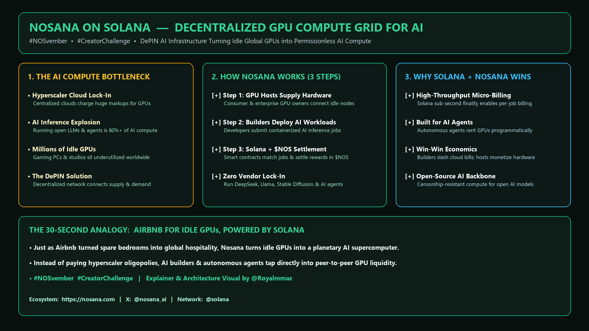

# Explaining Nosana (`#NOSvember`): How Idle GPUs Become an AI Inference Grid on Solana

*By Marco Aurélio Sugamele ([`@Royalmmac`](https://x.com/Royalmmac))*

- **5-Part X Thread ([`@Royalmmac`]):** [`https://x.com/Royalmmac/status/2121298173377364185`](https://x.com/Royalmmac/status/2121298173377364185) -> [`https://x.com/Royalmmac/status/2121299476488822915`](https://x.com/Royalmmac/status/2121299476488822915)
- **Website:** Nosana (`https://nosana.com`) • **Network:** Solana (`@nosana_ai` • `@solana`)
- **Campaign Tags:** `#NOSvember` • `#CreatorChallenge`

---

## 1. Explaining Nosana to a Friend in 30 Seconds

If a friend who is new to crypto and DePIN asks me what **Nosana (`@nosana_ai`)** actually does, here is the simplest way to put it:

> **Think of how Airbnb let people rent out spare bedrooms instead of building new hotels. Nosana does the same thing for AI compute: it connects idle GPUs sitting in gaming PCs, studios, and independent data centers around the world into a peer-to-peer GPU grid on Solana.**

---

## 2. Why AI Inference Needs a Decentralized Grid

Most people talk about the cost of *training* giant AI models, but for 99% of startups and indie developers, the real ongoing expense is **AI inference**—actually running open-source LLMs (like Llama, DeepSeek, or Mistral), image generators, and autonomous agents 24/7 for users.

Right now, builders face two connected problems:
1. **Cloud GPU Lock-In and Markups:** Renting dedicated GPU instances from legacy cloud providers is expensive, often gated by regional quotas, and locks small teams into rigid monthly contracts.
2. **Millions of Idle Consumer & Studio GPUs:** At the exact same time, millions of powerful GPUs around the world sit completely unused for 16+ hours a day.

---

## 3. How Nosana Connects the Two Sides

Nosana is a **DePIN (Decentralized Physical Infrastructure Network)** project built on **Solana (`@solana`)** that matches GPU supply with AI demand in three steps:

| Step | Who Is Involved | What Happens on Nosana |
| :--- | :--- | :--- |
| **1. Contribute Hardware** | **GPU Hosts** | Node operators connect their idle consumer or enterprise GPUs to the Nosana grid to earn rewards when their hardware runs jobs. |
| **2. Submit AI Workloads** | **Builders & AI Agents** | Developers package open-source AI models or agent inference tasks into containers and deploy them on demand. |
| **3. Coordinate & Settle** | **Solana + `$NOS`** | Nosana matches the workload to an available GPU node, runs the inference job, and settles payment on Solana using **`$NOS`**. |

---

## 4. Why Solana Is the Right Home for DePIN Compute

Coordinating thousands of independent GPU nodes requires fast state updates, job queuing, and frequent micro-payments.

Because Solana processes transactions in milliseconds for fractions of a cent, Nosana can match and settle on-demand inference jobs without eating up the cost savings in network fees. Even better, autonomous AI agents that already live on Solana can pay for their own GPU compute programmatically without needing a human credit card.

---

## 5. Learn More

- **Website:** [https://nosana.com](https://nosana.com)
- **Official X:** [`@nosana_ai`](https://x.com/nosana_ai)
- **Hashtags:** `#NOSvember` `#CreatorChallenge`
