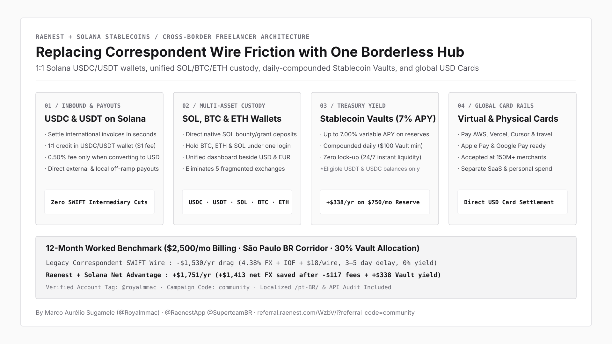

# How Brazilian Freelancers and Remote Engineers Are Using Raenest + Solana Stablecoins to Beat Cross-Border Banking Friction*By Marco Aurélio Sugamele ([`@Royalmmac`](https://x.com/Royalmmac)) • Published on [Substack](https://royalmmac.substack.com/p/how-brazilian-freelancers-and-remote) • **Interactive Calculator:** [`raenest-freelancer-calculator.html`](https://royalmmac.github.io/bounty-artifacts/raenest-freelancer-calculator.html)*---## The "Friday Afternoon Wire Trap" I Learned the Hard WayIf you work remotely from São Paulo, Buenos Aires, Lagos, or Manila for international clients, you already know the Friday afternoon wire trap.You wrap up a two-week engineering sprint on Friday at 4:00 PM. Your client sends an invoice payment across borders. With traditional correspondent banking, that transfer sits in limbo over the weekend, loses 3% to 6% in opaque FX spreads and intermediary bank deductions, and finally lands the following Wednesday.Working from Brazil and collaborating with global Web3 and software teams, I got tired of juggling five separate apps just to receive dollar payments, hold native crypto, earn yield on my tax reserve, and pay for cloud tools. That is the exact day-to-day problem [**Raenest**](https://www.raenest.com) solves.**Raenest** is a global financial platform built to help individuals and businesses manage money without borders. By combining multi-currency financial accounts with fast crypto and stablecoin rails (**USDT, USDC, SOL, BTC, and ETH**), Raenest replaces a fragmented stack of wallets, exchanges, and cards with one practical hub.Here is my hands-on breakdown of how I set up Raenest (signing up with campaign code **`community`** via [my referral link](https://referral.raenest.com/WzbV/i?referral_code=community)) and how the workflow operates in practice.---## 1. Receiving Client Invoices in USDC & USDT via Solana (1:1 USD Conversion)Take a concrete scenario: billing $2,500/month to an international startup plus bounty payouts from Web3 ecosystems.Instead of waiting days for an international SWIFT wire, the flow inside the **Raenest Crypto Wallet** is straightforward:1. **Fast Deposits on Supported Networks:** Inside Raenest, open the Crypto Wallet and select **USDC** or **USDT**. Raenest supports fast, low-cost networks like **Solana**, where settlement takes seconds and network fees cost a fraction of a cent.2. **Clean 1:1 USD Conversion:** When USDT or USDC arrives in Raenest via Solana, it credits with transparent **1:1 USD conversion**, with zero surprise correspondent bank deductions.3. **Direct Withdrawals:** Sending **USDT or USDC** out to contractors, suppliers, or external wallets across supported networks (or cashing out to local currency corridors) works the same way.---## 2. Depositing SOL and Managing BTC & ETH Under One RoofMost remote engineers, designers, and crypto-native contractors don't just hold stablecoins. Within the same Raenest dashboard, you can:- **Deposit SOL directly** into your Raenest Solana wallet address, which is especially convenient when you earn native SOL from hackathons, grants, or ecosystem bounties.- **Manage BTC, ETH, and SOL alongside your stablecoins:** Instead of jumping between multiple browser extensions and centralized exchanges to check balances, Raenest keeps **BTC, ETH, SOL, USDT, and USDC** in a single unified interface.---## 3. Putting Idle Working Capital to Work: Up to 7% APY in Raenest VaultsWhen an invoice arrives on the 1st of the month, I don't spend all of it on day one. Rent, local taxes, and software bills are spread across the month, and part of every payout stays in a dollar emergency reserve.Leaving stablecoins sitting in a standard wallet earns 0%. Inside **Raenest Vaults**:- **How it works:** You transfer eligible **USDT or USDC** balances from your main Raenest wallet into a **Raenest Vault**.- **Earn up to 7% APY:** Eligible stablecoin balances stored in Raenest Vaults earn **up to 7% Annual Percentage Yield (APY)**, generating predictable dollar-denominated returns on working capital.- **Important distinction to keep in mind:** The **up to 7% APY** applies specifically to **eligible USDT and USDC Vault deposits** (not to volatile assets like BTC, ETH, or SOL).
