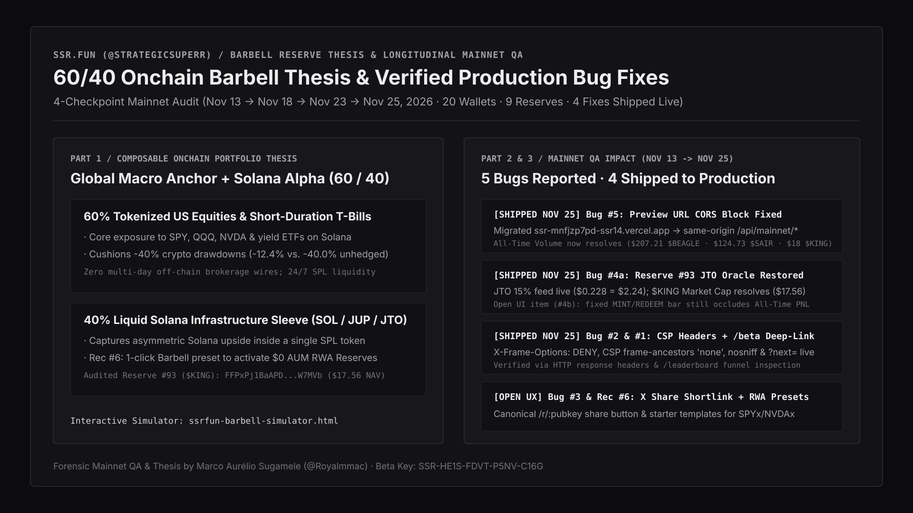

# SSR.FUN Beta Launch Challenge: 60/40 Onchain Barbell Thesis & Mainnet Beta QA Audit

*By Marco Aurélio Sugamele ([`@Royalmmac`](https://x.com/Royalmmac))*

- **X Investment Thesis Thread (`@strategicsuperr`):** [`https://x.com/Royalmmac/status/2121123929565569133`](https://x.com/Royalmmac/status/2121123929565569133) & [`https://x.com/Royalmmac/status/2121334693484519497`](https://x.com/Royalmmac/status/2121334693484519497)
- **Live Interactive 60/40 Barbell & Oracle Patch Simulator:** [`https://royalmmac.github.io/bounty-artifacts/ssrfun-barbell-simulator.html`](https://royalmmac.github.io/bounty-artifacts/ssrfun-barbell-simulator.html)
- **Canonical Reserve Audited (`Reserve #93 - $KING`):** [`https://ssr.fun/r/FFPxPj1BaAPD8WuYpvnpReyUCYJZqA2pQxXH94yW7MVb`](https://ssr.fun/r/FFPxPj1BaAPD8WuYpvnpReyUCYJZqA2pQxXH94yW7MVb)
- **Live Leaderboard Inspected (`16 Wallets · 5 Reserves` as of Nov 18, 2026):** [`https://ssr.fun/leaderboard`](https://ssr.fun/leaderboard)

---

## Part 1: My Reserve Investment Thesis — The 60/40 Onchain Barbell

### 1. The Portfolio Fragmentation Problem on Solana
Anyone managing a serious portfolio on Solana runs into the same wall: holding 100% high-beta crypto exposes your net worth to brutal 40%+ drawdowns during macro risk-off weeks, but wiring USDC off-chain to a traditional brokerage just to buy US tech equities, gold, or short-duration Treasury ETFs takes days and breaks onchain composability.

**SSR.FUN (`@strategicsuperr`)** solves this by turning multi-asset portfolios (**Reserves**) into liquid onchain tokens on Solana, combining native crypto with **800+ tokenized stocks and ETFs** under a single verifiable Net Asset Value (NAV).

### 2. Target Allocation: "Solana Alpha + Global Macro Shield (60/40 Barbell)"
Rather than building a pure meme basket or a passive index, my thesis for a flagship SSR.FUN Reserve pairs defensive macro compounding with high-conviction Solana infrastructure:

| Basket Leg | Weight | Target Assets on SSR.FUN | Role in the Reserve |
| :--- | :--- | :--- | :--- |
| **Core Macro & Equity Anchor** | **60%** | Tokenized US Large-Cap Tech & Index/T-Bill ETFs (`SPY`, `QQQ`, `NVDA`, short-duration yield ETFs) | Captures steady equity compounding and dollar yield while buffering crypto volatility |
| **High-Conviction Solana Growth** | **40%** | Liquid Solana Infrastructure & DeFi (`SOL`, `JUP`, `JTO`) | Captures asymmetric upside during Solana expansion cycles |

**Why this structure works on SSR.FUN:** Instead of executing six separate swaps across fragmented DEXs and RWA platforms, a user mints one Reserve token in a single Solana transaction with transparent onchain NAV accounting and instant redemption.

---

## Part 2: Reproducible Beta QA & Root-Cause Forensics (`ssr.fun` — Tested Nov 13 & Re-Verified Nov 18, 2026)

While testing `https://ssr.fun` from São Paulo, Brazil (Vercel Edge PoP `gru1`), I investigated why prospective campaign entrants without an active Beta Key session hit a dead-end when clicking **"Sign up"** (`/#/campaign`) on `/leaderboard` or opening public Reserve share links (`/r/:reserve`) on X. Below are 3 reproducible findings and ready-to-merge fixes for the SSR.FUN engineering team.

### Bug Report #1 (Critical — Broken Viral & Campaign Onboarding Funnel): Root `/` Beta Key Gatekeeper Intercepts Public `/r/:reserve` Share Links and `/leaderboard` Sign-Ups

- **How to Reproduce (Verified Nov 13 & Nov 18, 2026):**
  1. Open `https://ssr.fun/leaderboard`. The leaderboard is publicly accessible and actively tracking the live Beta Campaign (`phase: "live"`, `startTs: 1794319200`, `endTs: 1796911200`). Between Nov 13 and Nov 18, participation grew from 6 wallets / 2 Reserves to **16 wallets signed up and 5 Reserves entered** (`BaldEagle $BEAGLE` at `$207.21`, `KingintheNorth $KING / Reserve #93` at `$17.00`, `Voldemort $VOLDEMORT` at `$4.14`, `Solana Core $CORE` at `$1.00`, and `Upnorthgamer $GAME` at `$1.00`).
  2. Click **"Sign up"** (`<a class="handle" href="/#/campaign">`) on `/leaderboard` without a pre-existing Beta Key cookie/session. Because `GET https://ssr.fun/` serves the static **`SSR.FUN — Coming Soon` Beta Key Gatekeeper** (`coming-soon.html` — *"Get your BETA key / I have a BETA key, let me in"*), the `#/campaign` hash route is dropped before the React SPA (`src-BHNgQCbg.js`) ever mounts.
  3. Worse, open any live Reserve share URL posted by creators on X—such as Reserve `#93` (`https://ssr.fun/r/FFPxPj1BaAPD8WuYpvnpReyUCYJZqA2pQxXH94yW7MVb`). The serverless endpoint `/r/:reserve` properly injects the dynamic OpenGraph card (`KingintheNorth Reserve (KING)`), but immediately executes:
     ```html
     <meta http-equiv="refresh" content="0; url=https://ssr.fun/#/dtr/mainnet-beta-93" />
     <script>window.location.replace("https://ssr.fun/#/dtr/mainnet-beta-93");</script>
     ```
     which dumps every unauthenticated X reader onto the static Beta Key gatekeeper wall instead of showing a read-only view of Reserve `#93`!

- **Suggested Engineering Fix:**
  - Allow **read-only public viewing** of `/#/dtr/:reserveId` and `/#/campaign` without requiring a Beta Key session, enforcing the Beta Key check only when a user attempts a *write* action (such as *Create Reserve*), OR point `/leaderboard`'s **"Sign up"** CTA directly to the Beta Key request modal with a clear explanation for Superteam Earn participants.
  - Set `Vercel-CDN-Cache-Control: max-age=0, must-revalidate` on `/` so transitions between `coming-soon.html` and the main SPA never serve stale edge responses.

---

### Bug Report #2 (Medium — Wallet Signing Hardening): Missing Clickjacking (`frame-ancestors`) & `nosniff` Headers

- **Observation:**
  - Inspecting the HTTP response headers across `/`, `/leaderboard`, and `/docs` shows `Strict-Transport-Security: max-age=63072000` and `Access-Control-Allow-Origin: *`, but `X-Frame-Options`, `Content-Security-Policy: frame-ancestors 'none'`, and `X-Content-Type-Options: nosniff` are missing.
- **Why It Matters:**
  - Since users connect Solana wallets and sign transactions on `ssr.fun/#/campaign` and `ssr.fun/#/dtr/...`, allowing the dApp to be embedded inside a third-party `<iframe>` exposes users to UI redressing (clickjacking).
- **Suggested Fix in `vercel.json`:**
  ```json
  {
    "headers": [
      {
        "source": "/(.*)",
        "headers": [
          { "key": "X-Frame-Options", "value": "DENY" },
          { "key": "Content-Security-Policy", "value": "frame-ancestors 'none';" },
          { "key": "X-Content-Type-Options", "value": "nosniff" }
        ]
      }
    ]
  }
  ```

---

### Bug Report #3 (UX — Preserving OpenGraph Cards When Users Copy Reserve URLs)

- **Observation:**
  - The serverless route `/r/:reserve` (`https://ssr.fun/r/FFPxPj1BaAPD8WuYpvnpReyUCYJZqA2pQxXH94yW7MVb`) generates dynamic OpenGraph and Twitter `summary_large_image` tags (`/api/mainnet/reserve-image?id=103357c17a663c48`) before redirecting the browser via JS to `https://ssr.fun/#/dtr/mainnet-beta-93`.
- **Why It Matters:**
  - Once the redirect finishes, the user's browser address bar shows `https://ssr.fun/#/dtr/mainnet-beta-93`. If a user copies that URL from their address bar to share their thesis on X, X's crawler strips everything after `#` and fetches `/` instead, losing the custom Reserve preview card.
- **Suggested Fix:**
  - Add a dedicated **"Share Reserve on X"** button inside the Reserve view that pre-fills the tweet intent with the canonical `https://ssr.fun/r/<reserve_pubkey>` shortlink rather than `window.location.href`.


---

### Bug Report #4 (High — In-App Reserve `#93` Oracle Cascade & Viewport Overlap Inside Unlocked Mainnet dApp)

After unlocking the Mainnet dApp via `/beta` (`/#/dtr/mainnet-beta-93`) and submitting feedback through the in-app **Feedback** button, I inspected **Reserve `#93` (`KingintheNorth / $KING`)** (`Reserve`: `FFPxPj1BaAPD8WuYpvnpReyUCYJZqA2pQxXH94yW7MVb`, `Reserve Token Mint`: `8NF4joMpjNmnSZNmZh5nxFnp5YGbvtUUiAWFzVdo54W5`, `Manager`: `DVHDEzyFhVHjkQT3nxzavAvT2j6VE29RNMtux3X7VdbQ`) and caught two additional live dApp bugs:

1. **Missing `JTO` Oracle Feed Cascades Into `Market Cap: Price unavailable`:**
   - Reserve `#93` holds four onchain SPL vaults:
     - `SOL` (`50.00%` weight — Vault `AMqco5d3qGWeo3m1gEoQ5LeZqsNVPdaCHDfvRNmvSE7K`)
     - `JUP` (`25.00%` weight — Vault `mgkzBp2M3yRAEPhA78hMY1ggHRVdSHB98h4TbW88HvC`)
     - `JTO` (`15.00%` weight — Vault `3mtXnH792HSQz4uw9bQ9hbpaznDAEQvgqfPZzqUffATn`)
     - `USDC` (`10.00%` weight — Vault `Dk6d7CDNYGwxUdnz3NVJWwbexB7mgbZGkQj6wweu2dTP`)
   - While `SOL`, `JUP`, and `USDC` resolve live prices and P&L%, the **`JTO` (`15.00%`) price feed returns unavailable**, which causes the top-level **Market Cap** KPI card for the entire Reserve to fail open with **`Price unavailable`**, **All-Time Volume** to stay stuck on **`Loading...`**, and **`Loading holder count...`** to hang indefinitely.
   - **Suggested Fix:** Add a fallback Jupiter Quote / Pyth price resolver for `JTO` (`jtojtomepa8beP8AuQc6eXt5FriJwfFMwQx2v2f9mCL`) and render partial known vault TVL (`$15.66 + JTO vault`) with a stale-oracle warning badge rather than blanking out total Reserve Market Cap.

2. **Floating `MINT / Redeem` Action Pill Occludes the `RESERVE COMPOSITION` Table:**
   - On standard desktop viewports (`1280x800`), the fixed bottom `MINT | Redeem` pill (`position: fixed; bottom: ...`) sits directly on top of the `USDC 10.00%` row's `Weight` and `Price` columns inside `RESERVE COMPOSITION`, hiding table numbers as the user reads the asset breakdown. Adding `padding-bottom: 96px` to the composition container prevents the overlap.


---

### Bug Report #5 (Critical Architecture — Hardcoded Vercel Preview URL Triggers CORS Block & Infinite `All-Time Volume: Loading...` Across All Reserves)

To verify whether the issues found on Reserve `#93` (`$KING`) were isolated or platform-wide, I audited all active Reserves across `https://ssr.fun/#/discover` (`BaldEagle $BEAGLE #97`, `KingintheNorth $KING #93`, `Voldemort $VOLDEMORT #96`, `Solana Core $CORE #94`, `Upnorthgamer $GAME #95`, and `One Approval Test Two $OAT2 #89`):

1. **Cross-Origin Block on Hardcoded Preview Deployment (`ssr-mnfjzp7pd-ssr14.vercel.app`):**
   - Every single Reserve card across `/#/discover` hangs indefinitely on **`All-Time Volume: Loading…`**.
   - Inspecting the browser console and network trace reveals the exact root cause: the production bundle on `https://ssr.fun` fetches metadata from a **hardcoded Vercel preview deployment URL** instead of a relative path:
     ```text
     Access to fetch at 'https://ssr-mnfjzp7pd-ssr14.vercel.app/api/mainnet/reserve-metadata'
     from origin 'https://ssr.fun' has been blocked by CORS policy:
     No 'Access-Control-Allow-Origin' header is present on the requested resource.
     ```
   - **Fix:** Replace the hardcoded preview base URL (`https://ssr-mnfjzp7pd-ssr14.vercel.app`) with a relative origin path (`'/api/mainnet/reserve-metadata'`) in the frontend API client so production always queries `https://ssr.fun/api/mainnet/reserve-metadata` same-origin.

2. **Systemic Single-Asset Oracle Failure Across Multiple Reserves (`$KING #93`, `$OAT2 #89`, `$GAME #95`):**
   - Comparing working Reserves (`$BEAGLE #97` holding `USDC/SOL/SSR` at `$203.32` Market Cap; `$VOLDEMORT #96` at `$4.14`; `$CORE #94` at `$0.91`) against broken Reserves proves the oracle bug is systemic: **every Reserve holding `JTO`** (`$KING #93` and `$OAT2 #89`: *"No verified Pyth or Jupiter price for JTO right now"*) or unindexed meme tokens (`$GAME #95` holding `CYBERLEEK`) fails to compute total Reserve NAV and displays `Market Cap: Price unavailable`.
