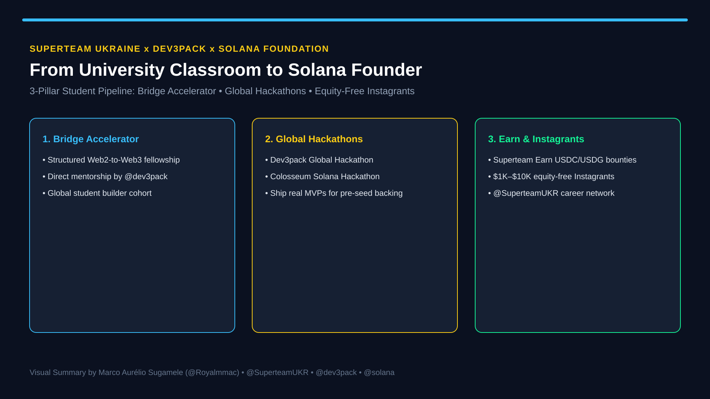

# From University Classroom to Solana Founder: Key Takeaways from the Superteam Ukraine x Dev3pack x Solana Foundation Student Workshop

**Author:** Marco Aurélio ([`@Royalmmac`](https://x.com/Royalmmac))  
**Ecosystem Partners:** Superteam Ukraine ([`@SuperteamUA`](https://x.com/SuperteamUA)) • Dev3pack ([`@dev3pack`](https://x.com/dev3pack)) • Solana Foundation ([`@solana`](https://x.com/solana))  
**Workshop Date:** November 10, 2026

---

## 1. Bridging the Gap Between Student Talent and the Global Crypto Economy

For university students studying computer science, design, economics, or marketing, breaking into Web3 often feels overwhelming. Where do you find mentors? How do you transition from textbook projects to shipping real onchain applications? And how do you fund your first prototype without giving up equity or waiting months for venture capital?

On **November 10th**, **Superteam Ukraine ([`@SuperteamUA`](https://x.com/SuperteamUA))**, **Dev3pack ([`@dev3pack`](https://x.com/dev3pack))**, and the **Solana Foundation ([`@solana`](https://x.com/solana))** hosted a dedicated **Opportunities for Students Workshop** that mapped out a complete, step-by-step career and founder pipeline for students entering the Solana ecosystem.

---

## 2. Pillar 1: Structured Acceleration — The Dev3pack Bridge Accelerator

Instead of throwing beginners into the deep end, **Dev3pack ([`@dev3pack`](https://x.com/dev3pack))** supports student developers and youth builders with structured fellowship and acceleration programs:
- **The Bridge Accelerator by Dev3pack:** Designed specifically to guide emerging student builders from Web2 fundamentals into production-ready Web3 engineering and product execution.
- **Hands-On Mentorship & Global Cohort:** Students gain direct access to experienced technical mentors, workshops, and an international peer network of ambitious young founders.

---

## 3. Pillar 2: High-Stakes Proof-of-Work — Global Hackathons

In the Solana ecosystem, a live hackathon MVP speaks louder than any GPA or static resume. The workshop highlighted two flagship arenas where students can test their skills globally:

1. **The Dev3pack Global Hackathon:** A student-friendly global competition offering dedicated tracks, mentorship, and prize pools tailored for university and youth teams shipping their first Web3 products.
2. **The Colosseum Solana Hackathon:** Solana's premier global startup competition—where winning student teams frequently secure pre-seed funding, accelerator admission, and global visibility across the Solana ecosystem.

---

## 4. Pillar 3: Non-Dilutive Funding & Immediate Earning — Superteam Ukraine & Instagrants

Once a student team has a working concept or wants to start earning while learning, **Superteam Ukraine ([`@SuperteamUA`](https://x.com/SuperteamUA))** provides the direct economic gateway:
- **Superteam Instagrants:** Fast-track, equity-free micro-grants (`$1,000` to `$10,000`) with rapid turnaround times, empowering students to fund prototypes, research, or community initiatives without bureaucracy.
- **Superteam Earn Bounties:** Students can immediately start earning `USDC`, `USDG`, and `SOL` by competing in open code, content, design, and growth bounties from top Solana protocols.
- **Local Community & Career Launchpad:** Through Superteam Ukraine's local events, co-working sessions, and founder network, students gain a direct bridge from their first bounty submission to full-time Web3 careers.

---

## 5. Actionable 3-Step Checklist for Students

1. **Follow & Connect:** Follow [`@SuperteamUA`](https://x.com/SuperteamUA) and [`@dev3pack`](https://x.com/dev3pack) on X to catch the next cohort openings and workshop sessions.
2. **Join an Accelerator & Hackathon:** Apply to the **Dev3pack Bridge Accelerator** and form a team for the **Dev3pack Global Hackathon** and **Colosseum Hackathon**.
3. **Build & Apply for Instagrants:** Ship your MVP on Solana, earn your first crypto payouts on **Superteam Earn**, and apply for a **Superteam Ukraine Instagrant** to scale your project!
